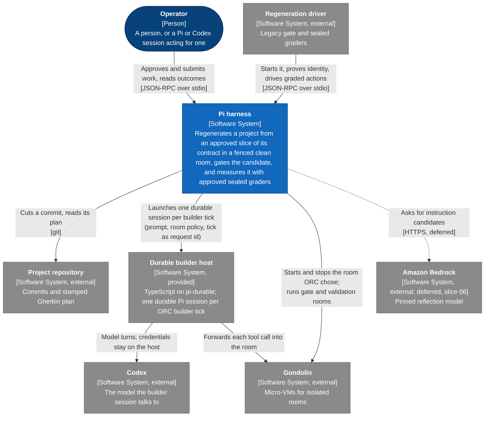
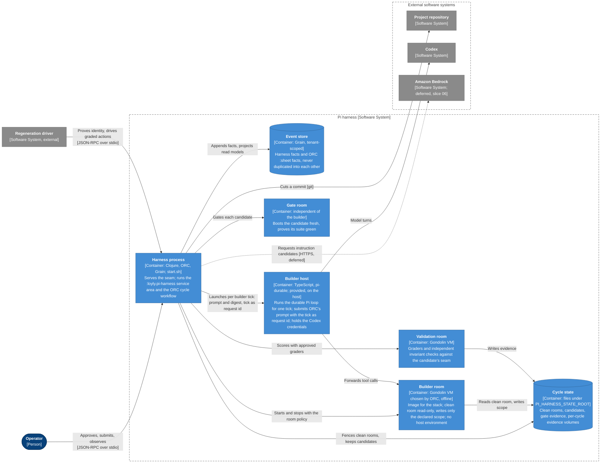
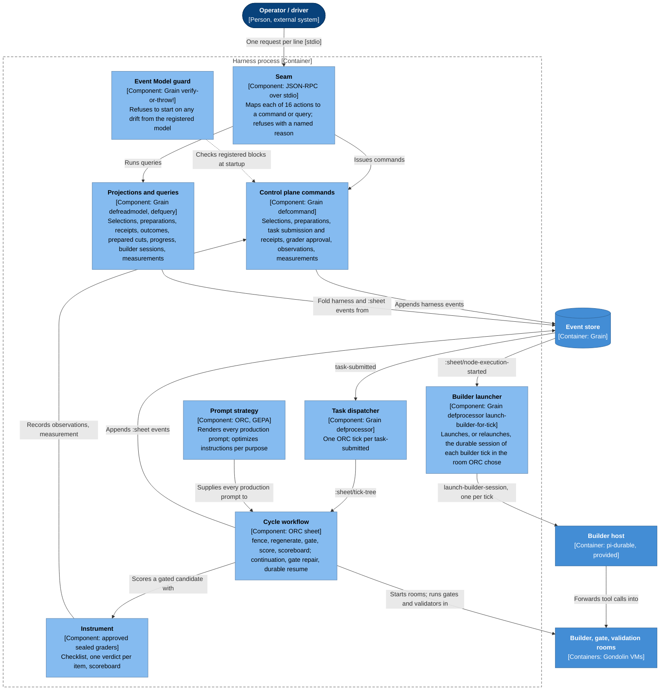

# Pi harness architecture

The architecture the contract in [`.pi/model/`](model/) specifies. It describes the target,
derived from the model alone; it makes no claim about any implementation. Where this page and
the model disagree, the model wins.

## C4 views

Three levels, following the `c4-diagrams` skill. Every element and relationship is taken from
the model: ORC is a library, so it runs inside the harness process and appears only as
components; Grain's event store is a data store; the builder, gate, and validation rooms are
runnable containers.

### Level 1: System Context

Who uses the harness and what it depends on.



- The **operator** is `actor Operator`, identified by its `OperatorSession`. Exploratory
  transcripts, skills, and branches stay in the operator session; only an approved preparation
  crosses into ORC.
- The **regeneration driver** (the legacy gate and sealed graders) reaches the harness only
  through the seam, exactly like the operator.

### Level 2: Container

The runnable parts of the harness and the stores they use.



- The **harness process** is one container: `start.sh` starts it, it serves the seam, and it
  runs both the `:loyly.pi-harness` service area and ORC's cycle workflow.
- The **event store** holds harness facts and ORC's `:sheet` facts; neither is copied into the
  other. **Cycle state** is the harness's file state under `PI_HARNESS_STATE_ROOT`; a fresh
  directory means fresh state.
- **Rooms** are isolated from each other and from the builder: the builder never controls the
  gate, and score evidence never reaches a builder.

### Level 3: Component (harness process)

The responsibilities inside the harness process.



- **Approval starts nothing.** Commands append facts; the task dispatcher turns each
  `task-submitted` into exactly one ORC tick.
- Projections and queries only read; progress and builder-session views never advance ORC.
- The instrument reports to a person and never feeds the build loop.
- The Event Model guard refuses to start when the registered model and the live registries
  disagree.

Assumptions: the model names Gondolin and the host as execution backends but no deployment
topology, so there is no deployment view. ORC's internals are out of scope (ORC's own
`specs/orc-service.allium`).

## The seam

`APP_DIR/start.sh` reads one JSON request per line on stdin and writes one response per line
on stdout; every request gets exactly one response carrying its id. `PI_HARNESS_PROJECT_ROOT`
names the repository worked on; `PI_HARNESS_STATE_ROOT` holds the harness's own state, and a
fresh directory means fresh state.

| Group | Actions (method) |
|---|---|
| Cycle | `CycleContract` (`cycle-contract`), `WorkflowContract` (`workflow-contract`), `SubmitCycle` (`submit-cycle`), `Wait` (`wait`), `ExecutionStatus` (`execution-status`) |
| Cut and selection | `PrepareCut` (`prepare-cut`), `SliceComposition` (`slice-composition`), `PreviewSelection` (`preview-selection`), `ApproveSelection` (`approve-selection`) |
| Preparation | `PrepareCycle` (`prepare-cycle`), `ApprovePreparation` (`approve-preparation`), `SubmitApprovedSlice` (`submit-approved-slice`) |
| Instrument | `ApproveGrader` (`approve-grader`), `Measurement` (`measurement`) |
| Builder sessions | `BuilderSession` (`builder-session`) |
| Prompt optimization | `OptimizePrompt` (`optimize-prompt`) |

Each action names the Allium rule its outcomes and rejections realise and the Grain command or
query it reaches. A rejection is a refused response naming what and why; the harness keeps
running.

## Control plane

```text
prepare-cut ─► slice-composition ─► preview-selection ─► approve-selection
                                                              │
                         prepare-cycle ─► approve-preparation ┘
                                │
              submit-approved-slice ──┐        submit-cycle (whole plan) ──┐
                                      ▼                                    ▼
                               task-submitted ─► dispatch-submitted-task ─► :sheet/tick-tree (ORC)
                                                                                 │
              execution-status ◄─ cycle-progress ◄─ :sheet/* events ◄────────────┤
              wait             ◄─ task-outcomes  ◄─ :sheet/tree-tick-completed ◄─┘
```

- Every identity is deterministic: previewing or preparing the same choices again returns the
  same identity and digest, and approval accepts only that exact digest.
- **Approval starts nothing.** ORC is dispatched once per submitted task.
- A **slice cycle** runs an approved preparation, which binds the selection, scope, target
  stack, execution profile, cut digest, grader digest, diagram digest, and outer-cycle budget.
- A **whole-plan cycle** (`submit-cycle`) runs the whole plan of the pinned cut under a fixed
  preparation (configured scope, stack, and profile, approved graders, one outer cycle);
  submitting it is that preparation's approval, as in the legacy shape.
- Repeating a request identity returns the original receipt; reusing it for a different
  request is refused. A replacement worker answers `wait` from ORC's durable state and never
  reruns a task.
- Progress and builder-session views are projections of ORC facts; they never advance ORC.

## The cycle

```text
fence → regenerate → gate → score → scoreboard
```

| Stage | Behaviour |
|---|---|
| fence | Builds a clean room from the pinned cut only after the harness self-check passes. The fence is physical: fenced paths are absent from the tree and the object graph. |
| regenerate | One fresh builder session per slice, in plan order, each extending the cycle's candidate; continued in the same session at most three times while its slice is uncarried. The builder reads the clean room read-only and writes only its declared scope. |
| gate | A room the builder does not control boots the candidate fresh and proves its suite green. A failed gate may start a fresh repair builder with only the previous candidate and the gate's evidence, at most three attempts. |
| score | Approved sealed graders file one verdict per checklist item through the seam. An unreached item fails and stays in the denominator. |
| scoreboard | Compares with the previous cycle on shared items, newly passing and newly failing separately; new items are the untuned holdout; never a net. |

The fence and the gate are the **harness** and feed the build loop. The score and the
scoreboard are the **instrument** and never do: no score evidence reaches a builder, and a
failed score is measured, not retried within the cycle.

## Grain service area

`:loyly.pi-harness` (`event-model/loyly/pi_harness/event_model.clj`):

| Concern | Commands | Events | Read models → queries |
|---|---|---|---|
| Selection | `record-selection`, `approve-selection` | `selection-recorded`, `selection-approved` | `selections` → `selection` |
| Preparation | `record-cycle-preparation`, `approve-cycle-preparation` | `cycle-preparation-recorded`, `cycle-preparation-approved` | `cycle-preparations` → `cycle-preparation` |
| Tasks | `submit-cut-task`, `submit-cycle-task`, `submit-whole-plan-cycle`, `record-task-receipt` | `task-submitted`, `task-receipt-issued` | `task-receipts` → `task-receipt`, `highest-task-id`; `task-outcomes` → `task-outcome` |
| Cuts | | | `prepared-cuts` → `slice-composition` |
| Progress | | | `cycle-progress` → `cycle-progress`; `builder-sessions` → `builder-session` |
| Builder sessions | `launch-builder-session`, `relaunch-builder-session`, `bind-workspace-generation` | `builder-session-launched`, `builder-session-resumed`, `workspace-generation-bound` | `builder-sessions` → `builder-session` |
| Instrument | `approve-grader`, `record-observation`, `record-cycle-measurement` | `grader-approved`, `observation-recorded`, `cycle-measurement-recorded` | `approved-graders`, `cycle-observations`, `cycle-measurements` → same-named queries |
| Prompt optimization | `start-prompt-optimization` | `prompt-optimization-started` | `prompt-optimizations` → `prompt-optimization` |

Two todo processors: `launch-builder-for-tick` launches, or relaunches, the durable Pi session of
each ORC builder tick (`launch-builder-session`, `relaunch-builder-session`,
`bind-workspace-generation`). `dispatch-submitted-task` turns each `task-submitted` into ORC's
`:sheet/tick-tree`. One screen, `pi-regeneration`, is the operator's control surface. Every
command links an Allium rule and the screen links the `RegenerationControlPlane` surface.

`:sheet` (`event-model/orc/sheet/event_model.clj`) declares the ORC blocks the area uses: the
command `tick-tree` and the events `tree-tick-started`, `node-execution-started`,
`node-execution-completed`, `tree-tick-completed`, and `tick-cancelled`, copied from ORC's
pinned `orc-service` schemas. Startup validates the registered model strictly against the live
registries and refuses to start on drift.

## Instrument

- The **checklist** is one item per stamped scenario of the approved selection, derived and
  never written; an unstamped scenario or an empty selection stops the cycle.
- A **grader** is written once from the selected Gherkin and the public calibration protocol by
  an author who cannot read any candidate, transcript, or prior verdict. It is calibrated so
  carried behaviour passes and uncarried behaviour fails, sealed by digest, discarded and
  re-authored at most three times if uncalibrated, and used only after the operator approves
  its exact digest. It is reused until its scenarios change and replaced only for a recorded
  reason; never to turn a score green.

## Runtime evidence

Producers record runtime signals with their authority (candidate, harness observer,
independent validator) and purpose (assertion, diagnostic, calibration). Only an independent
validator files a verdict, only from complete, unsampled collection; incomplete collection is
inconclusive, and a diagnostic signal never decides a verdict. Validation runs in an
independent room with a pinned read-only capture policy and a per-cycle writable evidence
volume; a passing baseline is bound to its complete Playwright trace. Reports are projections
and never authority.

## Prompt optimization

ORC owns every production prompt. A builder instruction is optimized per purpose (fresh
generation, verification repair) as a complete strategy: GEPA proposes candidates through a
pinned Bedrock reflection model, each candidate is measured by independent regeneration, and
the winner is activated durably with its provenance. The builder cannot author its own metric,
and enforcement never depends on the prompt being followed.

## Durable builder sessions

Every agent step of the cycle is a durable Pi builder session that ORC launches: the slice
builder (and its continuations), the repair builder after a failed gate, and the grader author.
The work is split so that ORC decides everything and the provided builder host only runs the
model loop.

| ORC (in the harness process) | Provided builder host (TypeScript, `@earendil-works/pi-durable`) |
|---|---|
| The stages, one tick per builder attempt, limits, timeouts, cancellation, resume | Runs the durable Pi agent loop: model turns and tool calls are committed before they count |
| The production prompt for each role and its digest | Submits ORC's prompt with the tick as its request identity, so a relaunch resumes |
| The room policy: builder image for the stack, cut read-only, scope-only writes, gate evidence read-only for a repair, only Gherkin and protocol for a grader author, no egress, no host environment | Connects to the model (Codex) with credentials that stay on the host |
| Starts and stops the Gondolin room | Forwards each tool call into that room; it cannot widen it |
| Records session ↔ tick, progress, and outcome as Grain facts (`builder-sessions`) | Reports committed tool results and the outcome |
| Binds a workspace generation to each committed tool result | |

A relaunch of the same tick resumes the same session from its committed turns and never starts a
second one (`02-018`). ORC alone chooses the room (`02-019`). The builder host and the Gondolin
images (`harness/Makefile`, `harness/<project-id>/`, `.pi/harness/config/`) are provided, like
ORC and Grain, and checked by their own tests, not by the checklist. The gate and validation
rooms use Gondolin directly, without Pi.

## Where the model states it

| Concern | Gherkin slice | Allium | Grain | Seam |
|---|---|---|---|---|
| Cuts, selection, preparation, cycles | `01-regeneration-cycle` | `regeneration-cycle.allium` | selection, preparation, cuts | cut and selection, preparation |
| The cycle's stages | `02-execution-pipeline` | `execution-pipeline.allium` | | `CycleContract`, `WorkflowContract` |
| Instrument | `03-instrument` | `instrument.allium` | instrument | `ApproveGrader`, `Measurement` |
| Control plane | `04-operator-control-plane` | `operator-control-plane.allium` | tasks, progress, dispatch | cycle, builder sessions |
| Runtime evidence | `05-runtime-evidence` | `runtime-evidence.allium` | `record-observation` | |
| Prompt optimization | `06-prompt-optimization` | `prompt-optimization.allium` | prompt optimization | `OptimizePrompt` |
| The seam | `09-rpc-seam` | | | `affordances.yaml` `seam` |

[`model/COVERAGE.md`](model/COVERAGE.md) holds the exact mappings, the ownership between Allium
files, the verification commands, and the diagnostic baseline (no Allium errors or warnings;
Grain's composition gate clean). The vocabulary is [`model/GLOSSARY.md`](model/GLOSSARY.md);
the decisions are in [`model/docs/adr/`](model/docs/adr/).
