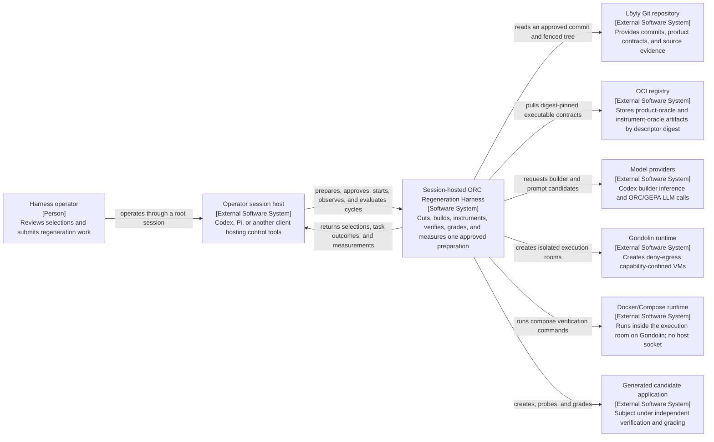
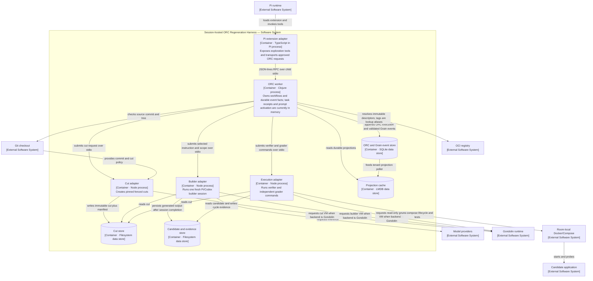
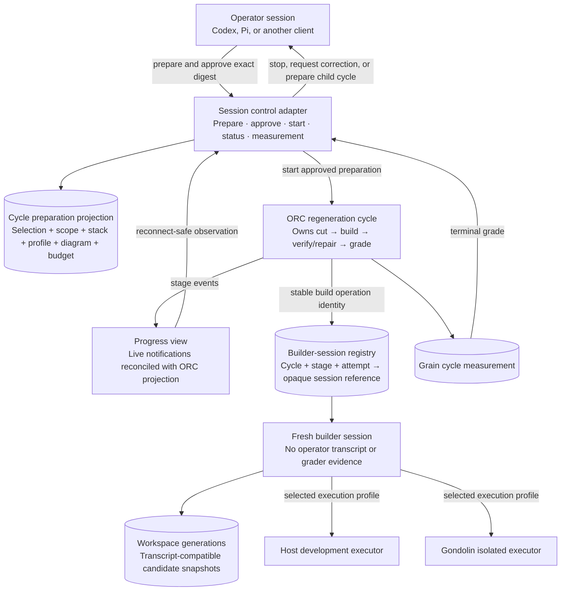
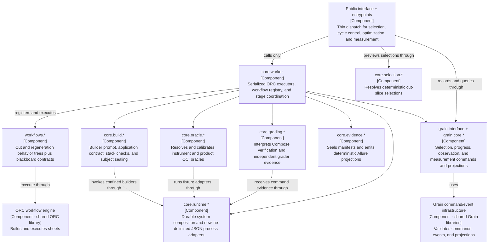
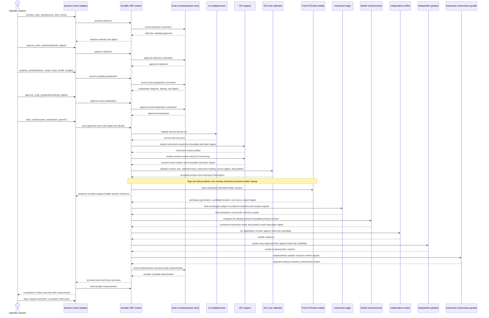
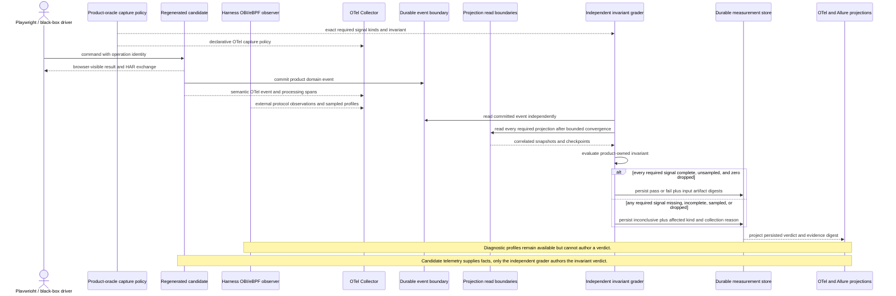
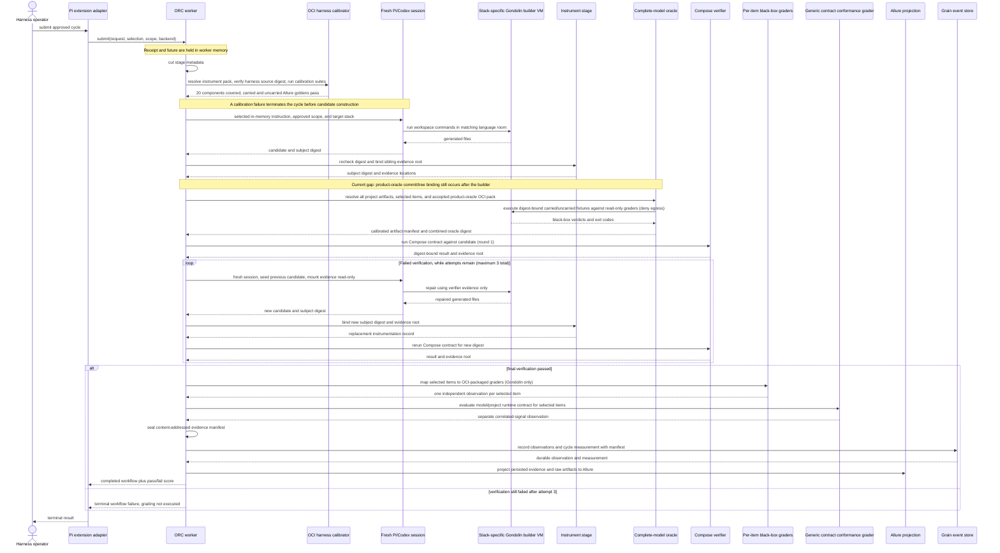

# Session-hosted ORC regeneration harness architecture

Status: regenerated from `.pi/model` with explicit current-implementation annotations, 2026-11-03

Audience: engineers evolving or reviewing the Pi regeneration harness

Decision supported: where workflow, isolation, persistence, prompt, and evidence responsibilities belong

## Scope

The software system in scope is the **Session-hosted ORC Regeneration Harness**. It turns a
pinned and fenced repository cut into a generated candidate, independently verifies and
grades that candidate, and records an evidence-backed measurement.

Inside the boundary are the session-agnostic control adapter, the ORC worker, its narrow
Node adapter processes, and harness-owned state. Outside are the operator session host
(Codex, Pi, or another client), source repository, model providers, Gondolin runtime,
OCI registry, Compose runtime, and generated candidate application.

This document uses C4 terminology. A container is a runnable process or data store, not
necessarily a Docker container. The diagrams distinguish normative target behavior from
the current implementation. Observable behavior remains authoritative in
[`.pi/model`](../.pi/model/README.md), and the implementation
conformance inventory is retained in Appendix A below.

The System Context, Container, and ORC component views are the structural C4 views. The
operator/session responsibility map and the deployment/security map are supporting views:
they deliberately combine C4 elements with approval records, projections, filesystem mounts,
and capability boundaries that are not themselves C4 elements. Dynamic views reuse the named
C4 elements to explain one runtime scenario at a time.

## System Context

Question answered: who uses the harness, what is inside its boundary, and which external
systems must it integrate with?



The legacy Löyly harness is a migration parity reference, not a runtime dependency. Its
refusal, skip, timeout, and evidence behavior must remain visible until the ORC path matches
it.

## Container view

Question answered: which runnable applications and data stores implement the harness, and
how do they communicate?



### Runtime-element responsibilities

| Runtime element | C4 type | Owns | Must not own |
|---|---|---|---|
| Session control adapter | Container | Read-only composition inspection, deterministic selection preview, approval transport, worker lifecycle, and JSON transport | ORC stage ordering, inner retries, scoring, prompts, or exploratory transcript authority |
| ORC worker | Container | Cut, prompt, and cycle workflows; selection approval; stage gates; evidence reduction. ORC/Grain facts are durable, but task receipts and prompt activation currently are not | VM implementation or Pi UI behavior |
| Cut adapter | Container | Physical fence, commit/tree pins, immutable cut manifest | Selecting the regeneration scope |
| Builder adapter | Container | Fresh builder session and confined workspace tools; target session references and workspace generations | Grading, oracle, final measurement, production prompt selection |
| Execution adapter | Container | Verifier and grader command execution in an independent room | Changing the candidate or denominator |
| SQLite event store | Container / data store | ORC execution events and harness Grain facts | Product-domain event ownership |
| LMDB projection cache | Container / data store | Durable selection, progress, and measurement read models | Authoritative event history |
| Cut store | Container / data store | Fenced, history-pruned repository cuts | Candidate writes or prior implementation answers |
| Candidate/evidence store | Container / data store | ORC-persisted generated output, raw cycle evidence, and report projections | Authoritative verdict calculation |

Oracle resolution and calibration are components inside the ORC worker, not independently
runnable containers. They resolve product and instrument OCI descriptors and validate commit,
tree, selected items, and cross-oracle binding before builder startup; they must not make
candidate-behavior decisions or treat mutable tags as authority.

## Supporting responsibility view: target operator and builder sessions

Question answered: how can any main session approve and observe a cycle while ORC retains
the complete inner workflow and builder attempts remain separately inspectable?

This is not a separate C4 abstraction level. It overlays the operator-facing containers with
approval records, projections, session references, and workspace generations to make ownership
and lifecycle decisions explicit.



The **cycle preparation** is the approval boundary. Its digest binds the approved selection,
candidate scope, target stack, execution profile, pinned cut and oracle identities, rendered
diagram, and outer-cycle budget. Changing any bound field creates a new preparation.

The operator session is not part of ORC execution state. Disconnecting it does not stop a
cycle. Live events improve responsiveness, but reconnecting clients query ORC's durable tick
projection and Grain's measurement projection before rendering progress.

Each initial build and verification repair has a distinct builder-session reference keyed by
cycle, stage, attempt, and stable operation identity. Read-only observation does not affect
candidate provenance. Pause, steer, or fork is an explicit intervention, is allowed only at a
safe boundary, and marks resulting work as assisted. Completed sessions are never silently
mutated; further work uses a fork or a new cycle.

The current builder persists committed Pi model turns and tool results under a separately
identified, read-only builder-session reference, alongside tool-call count and the generated
top-level workspace entries. This supports inspection, not restoration. A future durable resume
must bind the transcript to the exact VM-visible workspace generation; completed candidate output
alone is not sufficient for that stronger guarantee.

## ORC worker component view

Question answered: how are responsibilities divided inside the ORC worker?



ORC's `:sheet/*` events describe execution. Grain events in this worker describe selection
and cycle-preparation approval, observations, and measurements. Product-domain events belong
to the generated application and are not duplicated here. Supporting `core` components do
not depend on `core.worker` or the public interface; dependency direction points toward pure
interpretation and runtime boundaries, never back toward orchestration.

## Dynamic view: target regeneration cycle

Question answered: what is the required order and which boundary is responsible at each
step? This is the normative target from [`AGENTS.md`](AGENTS.md), not a claim that every
current implementation gap has been closed.



## Dynamic view: target runtime evidence

Question answered: how do language-independent runtime signals support, but not author, a
product invariant verdict?



## Dynamic view: current regeneration cycle

Question answered: what does the checked-in implementation actually execute today? This
diagram is descriptive, not normative.



## Deployment and security perspective

Question answered: where do instances run, and which mounts and capabilities cross trust
boundaries?

This view maps C4 container instances onto deployment nodes, then overlays filesystem mounts
and kernel capabilities because those security boundaries determine whether a grade can ratify
a candidate. Mount and capability nodes are annotations, not additional C4 containers.

```mermaid
flowchart TB
    subgraph host["Developer host — Deployment Node"]
        pi["Pi process + extension<br/>[Container instance]"]
        worker["Clojure ORC worker<br/>[Container instance]"]
        adapters["Node cut and execution adapters<br/>[Container instances]"]
        builderagent["Fresh Pi/Codex builder session<br/>[Node adapter instance]<br/>Model inference and session state remain on host"]
        state[(".pi/harness/.state<br/>SQLite, LMDB, candidate outputs")]
        cuts[("Cut root outside source tree<br/>immutable cuts and manifests")]
        repo[("Löyly Git checkout<br/>source and contract evidence")]
        oci[("OCI artifact cache<br/>descriptor-pinned product and instrument oracles")]
    end

    subgraph cutvm["Gondolin cut VM — deny egress"]
        cutproc["Cut process<br/>[Container instance]"]
        sourceMount[("/source — read-only")]
        outputMount[("/output — writable staging")]
    end

    subgraph buildervm["Language-specific Gondolin builder command VM — deny egress"]
        builderproc["Rust, Java, Rails, or Node-family commands<br/>[Sandbox process]"]
        cutMount[("/cut — read-only")]
        workspaceMount[("/workspace — candidate seed; writes limited to declared scope")]
        repairEvidence[("/evidence — failed verification evidence; read-only on repair rounds")]
    end

    subgraph gradervm["Gondolin grader VM — deny egress"]
        graderproc["Verifier and grader commands<br/>[Container instance]"]
        roomdocker["Docker daemon + Compose<br/>[VM-local runtime · no host socket]"]
        subjectproc["Candidate application containers<br/>[Container instances]"]
        candidateMount[("/workspace — read-only merged candidate")]
        graderMount[("/grader — read-only grader extracted from pinned product OCI oracle")]
        observabilityMount[("/observability — read-only capture policy from product oracle")]
        evidenceMount[("/evidence — writable harness evidence only")]
        tracing[("tracefs + BPF FS — kernel observation capabilities")]
    end

    pi -->|"spawns over stdio"| worker
    worker -->|"spawns"| adapters
    worker -->|"spawns"| builderagent
    worker -->|"persists events and projections"| state
    adapters -->|"reads commit and policy"| repo
    worker -->|"resolves immutable descriptors"| oci
    adapters -->|"reads immutable cuts"| cuts
    adapters -->|"persists verifier and grader output"| state
    builderagent -->|"executes bash tool calls through"| builderproc
    builderagent -->|"persists completed generated output"| state
    repo -.->|"mounted as"| sourceMount
    cutproc -->|"reads"| sourceMount
    cutproc -->|"writes staged cut"| outputMount
    cuts -.->|"mounted as"| cutMount
    oci -.->|"extracts grader assets"| graderMount
    oci -.->|"extracts capture policy"| observabilityMount
    builderproc -->|"reads"| cutMount
    builderproc -->|"writes declared scope"| workspaceMount
    state -.->|"mounted only after failed verification"| repairEvidence
    builderproc -->|"reads diagnostics; never grader evidence"| repairEvidence
    graderproc -->|"reads candidate"| candidateMount
    graderproc -->|"reads probes"| graderMount
    graderproc -->|"reads capture policy"| observabilityMount
    graderproc -->|"runs OBI and OTel eBPF profiler"| tracing
    graderproc -->|"writes raw command evidence"| evidenceMount
    graderproc -->|"runs compose with evidence mount on app and test only"| roomdocker
    roomdocker -->|"writes project Playwright/OTel artifacts"| evidenceMount
    roomdocker -->|"starts and probes"| subjectproc
```



Gondolin rooms use synthetic DNS, deny HTTP requests and WebSockets, and do not expose the
operator transcript. The host backend preserves the logical paths but does not provide the
same isolation; in particular, host builder execution inherits the host process environment.
Independent grading currently requires Gondolin, so a host-backed cycle cannot claim a
complete independently graded pass.

## Data and event ownership

| Stream or artifact | Authority | Purpose |
|---|---|---|
| ORC `:sheet/*` events | ORC | Workflow execution, task progress, stage outcomes |
| `:loyly/selection-*` events | Harness Grain model | Exact reviewed and approved denominator |
| `:loyly/cycle-preparation-*` events | Harness Grain model | Exact reviewed and approved scope, stack, execution profile, pinned inputs, diagram, and outer-cycle budget |
| `:loyly/observation-recorded` | Harness Grain model | Evidence provenance for one cycle item and producer |
| `:loyly/cycle-measurement-recorded` | Harness Grain model | Immutable reduction of the approved denominator plus sealed evidence manifest |
| Sealed evidence manifest | Harness evidence store and Grain measurement | Content-addressed Compose, grader, Playwright, OTel, and other project artifacts |
| Generated product-domain events | `model/<project>` and candidate application | Business behavior of the regenerated product |
| Allure results and logs | Derived report store | Human- and tool-readable projections; never verdict authority |
| Cut manifest | Cut store | Commit, fenced tree, and source-commit pins |
| Product-oracle OCI descriptor | OCI registry and harness calibration | Executable product contract bound to Git commit, fenced tree, selected denominator, and instrument-oracle descriptor |
| Instrument-oracle OCI descriptor | OCI registry and harness calibration | Verdict-affecting harness source and calibration goldens |
| Runtime collection status | Independent grader and Grain measurement | Required signal kind, completeness, sampling, dropped count, and collection reason |

The harness must not introduce a second scope or item registry. Existing slices, `Rule:`
groups, and stable `@item-*` identities remain the measurement keys.

## Architectural invariants

1. ORC/Clojure owns workflow state, stage order, retries, scoring, and production prompt
   selection; TypeScript remains adapter code.
2. A cut is pinned before a cycle, physically fenced, outside the source tree, and mounted
   read-only wherever it is consumed.
3. A builder is a fresh, separately identified session with no operator transcript or skills,
   and writes limited to the declared candidate scope. Committed turns and tool results now
   persist for read-only inspection; binding them to a restorable matching workspace generation
   remains a target.
4. Product and instrument OCI tags are lookup aliases only. The cycle pins immutable descriptor
   digests, and product-oracle commit, tree, denominator, or instrument mismatches stop the builder.
5. Instrumentation, oracle, verifier, behavioral graders, instrument-conformance graders,
   and final measurement remain outside builder control and bind evidence to the same cut,
   subject, and oracle digests.
6. Missing, incomplete, sampled, or dropped required runtime signals are `inconclusive`, record
   their affected kind and reason, and cannot pass. Diagnostic profiles never author verdicts.
7. Missing or unreached items remain failed denominator items; zero or malformed grader
   output cannot pass.
8. Grain changes occur through command → validated event → projection, never bare event-store
   appends.
9. Generated output is persisted only from an ORC stage; report projections cannot change a
   recorded verdict.
10. Approval binds a complete cycle preparation, not only the selected denominator.
11. Progress notifications and builder-session views are observational; only ORC execution
   state advances the inner cycle.
12. Builder-session intervention is explicit, provenance-recorded, and never exposes
    same-cycle independent grader evidence to a repair builder.

## Evidence and traceability

- Engineering boundaries: [`AGENTS.md`](AGENTS.md)
- Pi tool boundary: [`harness/extension.ts`](harness/extension.ts)
- ORC public boundary: [`harness/orc-worker/src/loyly/pi_harness/interface.clj`](harness/orc-worker/src/loyly/pi_harness/interface.clj)
- ORC workflows: [`harness/orc-worker/src/loyly/pi_harness/workflows/regeneration.clj`](harness/orc-worker/src/loyly/pi_harness/workflows/regeneration.clj)
- Durable stores: [`harness/orc-worker/src/loyly/pi_harness/core/runtime/durable_system.clj`](harness/orc-worker/src/loyly/pi_harness/core/runtime/durable_system.clj)
- Builder isolation: [`harness/src/builder-room.ts`](harness/src/builder-room.ts)
- Grader isolation: [`harness/src/grader-room.ts`](harness/src/grader-room.ts)
- Cut fence: [`harness/src/cut.ts`](harness/src/cut.ts)
- Observable model: [`.pi/model/README.md`](../.pi/model/README.md)
- Session and cycle ownership decision: [`ADR 0001`](../.pi/model/docs/adr/0001-session-and-cycle-ownership.md)

## Assumptions and open questions

- The intended durable task contract is reconstruction from ORC state after worker restart;
  the exact public receipt and recovery mechanism still requires implementation design.
- Prompt activation needs a durable owner and rollback policy before optimized instructions
  can be treated as production configuration.
- The execution pipeline model requires explicit skip and timeout results; their precise ORC
  schemas remain to be selected.
- Host execution is useful for local diagnostics but is not equivalent to the Gondolin trust
  boundary and must remain visibly non-ratifying.
- Stack identity is enforced for the finite supported registry through language-specific
  Gondolin rooms and independent candidate checks. Extending the registry still requires a
  reviewed offline image and detector; this is not arbitrary-language support.
- Verification repair is deliberately bounded to three attempts and consumes only verifier
  evidence. Whether runtime instrument-conformance failures should enter a separate repair
  policy remains open; they do not do so today.
- Durable builder-session inspection retains append-only Pi transcripts now. Safe resume still
  requires a content-bound VM-visible workspace generation, which the current snapshot metadata
  does not provide.
- Read-only observation is the default. The exact authorization and UI protocol for pausing,
  steering, or forking an active builder session remains to be implemented.
- Outer-cycle continuation belongs to the operator session and must be bounded by the approved
  preparation budget. ORC's same-cycle verification repair is not an outer-cycle decision.


## Appendix A: implementation conformance

This appendix prevents the target diagrams from being mistaken for shipped behavior and is
the implementation-status record for the harness.

Status meanings:

- **Implemented**: current code satisfies the item within its stated backend and lifecycle
  preconditions.
- **Partial**: a usable path exists, but one or more modeled guarantees are absent.
- **Not implemented**: the modeled behavior is not supplied by the current path.

| Status | Items | Count |
|---|---|---:|
| Implemented | 01-001–005, 01-007–013, 01-018–019, 01-021–022, 01-024–025, 01-028–029, 01-033–034, 01-038, 01-042 | 24 |
| Partial | 01-006, 01-014–017, 01-020, 01-023, 01-026, 01-031, 01-036–037 | 11 |
| Not implemented | 01-030, 01-032, 01-035, 01-039–041 | 6 |

`01-027` was removed after its read-only observer and subject-preservation behavior was merged
into active `01-042`. Two instrument-conformance scenarios still lack stable `@item-*`
identities and therefore remain a traceability defect outside the 41-item denominator above.

### Executable acceptance coverage

| Model component | Scenario instances | Active E2E | Explicit skip |
|---|---:|---:|---:|
| Regeneration cycle | 15 | 6 | 9 |
| Operator control plane | 12 | 4 | 8 |
| Prompt optimization | 3 | 1 | 2 |
| Execution pipeline | 12 | 1 | 11 |
| Runtime evidence | 9 | 3 | 6 |
| **Total** | **51** | **15** | **36** |

### Item-by-item status

| Item | Status | Current implementation evidence or limitation |
|---|---|---|
| 01-001 | Implemented | Pinned cut creation is implemented in `harness/src/cut.ts`. |
| 01-002 | Implemented | Gondolin builder confinement is implemented in `harness/src/builder-room.ts`; supported target stacks select distinct offline rooms and unknown stacks fail closed. |
| 01-003 | Implemented | Deterministic unapproved selection identity is implemented by `selection_registry.clj`. |
| 01-004 | Implemented | Approval binds the selection identity and digest. |
| 01-005 | Implemented | Approved selection retrieval is supported by the durable entrypoint. |
| 01-006 | Partial | Request idempotency is held in worker memory and is lost on restart. |
| 01-007 | Implemented | The builder uses a fresh persisted Pi session, returns its distinct session identity in the builder result, and requires tool output. |
| 01-008 | Implemented | Compose structure, lifecycle, and supported-stack conformance checks are implemented. |
| 01-009 | Implemented | Verification output is captured by the cycle workflow; failed verification can drive a maximum-three-attempt repair loop through read-only evidence pointers. |
| 01-010 | Implemented | Binary item observations reduce into a cycle measurement. |
| 01-011 | Implemented | The grade gate preserves a valid poor score as workflow output. |
| 01-012 | Implemented | Observation and measurement schemas retain evidence identities and digests. |
| 01-013 | Implemented | Measurement reduction retains the complete supplied denominator. |
| 01-014 | Partial | Host cannot pass independent grading, and the terminal result does not preserve the modeled explicit limitation. |
| 01-015 | Partial | Full source-commit validation occurs after a cut task receipt is created. |
| 01-016 | Partial | Selection validation reads the legacy plan feature, not the complete project model. |
| 01-017 | Partial | Candidate-scope validation occurs during builder-room creation after submission. |
| 01-018 | Implemented | Repeated waits are stable only for the lifetime of the current worker. |
| 01-019 | Implemented | Unknown numeric task identities are rejected. |
| 01-020 | Partial | `start-cycle` plus `execution-status` reconstructs overall state from ORC's durable tick projection and startup resumes abandoned ORC frontiers; legacy numeric `submit`/`wait` receipts and futures remain process-local. |
| 01-021 | Implemented | Missing or non-vector GEPA example collections are refused. |
| 01-022 | Implemented | GEPA scoring is gated by full harness calibration, requires an approved selection, runs a fresh digest-identified candidate, validates the product oracle and Compose contract, and scores the complete independent per-item measurement. |
| 01-023 | Partial | A winner is independently selected, but activation remains only in worker memory and metric evidence is not yet sealed into a harness evidence manifest. |
| 01-024 | Implemented | ORC runs one slice cycle `cut → harness-snapshot → oracle → builder → instrument → verify → repair-verification → affordance-conformance → grade → instrument-conformance → repair-evaluation → conclude`, with the route selecting the oracle, grade, repair-evaluation, and conclude behavior; affordance conformance is capability-based, renderer-neutral, and non-applicable for slices not selected by the contract, calibration must pass before candidate construction, repair is limited to three verification attempts, and grading cannot start until the effective final verification passes. |
| 01-025 | Implemented | Instrumentation rechecks the builder digest and binds a sibling evidence root without modifying the candidate. |
| 01-026 | Partial | Product-oracle OCI validation exists, but the sharpened contract still needs E2E proof that commit, fenced tree, exact denominator, and instrument-oracle descriptor are verified before builder startup; mutable tags must never become authority. |
| 01-027 | Merged | Removed from the denominator; read-only mounts and before/after subject-digest preservation are exercised by active `01-042`. |
| 01-028 | Implemented | Observation validation preserves evidence provenance. |
| 01-029 | Implemented | Raw evidence is sealed into the persisted cycle measurement before Allure is derived; report loss cannot change the recorded verdict. |
| 01-030 | Not implemented | Non-success outcomes collapse, and failed stages do not persist a complete denominator measurement. |
| 01-031 | Partial | Runtime conformance is persisted under a distinct independent producer, but the observation schema does not yet encode the full candidate/observer/grader authority model. |
| 01-032 | Not implemented | The model now requires missing, incomplete, sampled, or dropped signals to persist `inconclusive` with affected kind and reason, but the E2E fault cases remain skipped. |
| 01-033 | Implemented | A generic, domain-free evaluator loads the selected project's runtime-evidence contract from the pinned cut, validates declared record cardinality, values, correlations, and `fields-equal` invariants, and emits a separate observation for every contracted selected item. Before persistence, every observation is enriched with all sealed input-artifact digests. Löyly has live runtime-evidence contracts for `@item-01-007` and `@item-01-008`; all eleven selected items are independently black-box graded. |
| 01-034 | Implemented | After Grain returns the persisted invariant observation, the harness derives both an Allure result and an OTLP JSON result span carrying the same deterministic evaluation identity, verdict, and sealed evidence-manifest digest; neither projection can author or alter the verdict. |
| 01-035 | Not implemented | Approval binds only the selection digest; scope, target stack, execution profile, pinned inputs, diagram, and outer-cycle budget are not one approved preparation. |
| 01-036 | Partial | The JSON control boundary exposes ORC `start-cycle` with caller-supplied durable identities and survives client disconnects, but no complete session-agnostic preparation contract or parent-cycle lineage exists. |
| 01-037 | Partial | The RPC reconciles authoritative ORC tick status with durable stage, attempt, and builder-session projections, and startup resumes abandoned ORC frontiers. Push notification subscription and automatic live rendering remain unimplemented. |
| 01-038 | Implemented | Each build attempt persists an append-only Pi transcript and a read-only RPC exposes committed turns, tool-call count, generated top-level entries, status, and progress. The E2E verifies observation does not alter transcript or candidate fixture content. |
| 01-039 | Not implemented | There is no explicit pause, steer, or fork protocol and no assisted-candidate provenance marker. |
| 01-040 | Not implemented | Pi transcripts and VM-visible workspace generations are not durably bound; only completed generated output is persisted. |
| 01-041 | Not implemented | A Pi operator session does not yet drive exploratory profiling inside Gondolin as a modeled, provenance-recorded operation. |
| 01-042 | Implemented | The active Gondolin E2E verifies read-only candidate and capture-policy mounts, the sole writable cycle evidence volume, before/after subject digest equality, the baked OBI/OTel eBPF toolchain, tracefs/BPF FS, and diagnostic-only OTLP policy. |

### Current supported boundary

- Full harness calibration: **implemented as a pre-builder gate**. ORAS resolves the pinned
  OCI instrument oracle, 20 logical components are required, the complete declared harness
  roots are content-bound, and the Clojure and Node suites must reproduce carried and
  uncarried normalized Allure goldens.
- Calibration granularity: **one aggregate `full-pi-harness` instrument**. Logical component
  omission and source drift fail closed, while the two golden fixtures exercise the complete
  suites rather than maintaining one executable fixture pair per component.
- Löyly product oracle: **implemented for all eleven booking-core items, but the new pre-builder
  Git commit/tree binding is not yet ratified**. The accepted
  OCI pack containing policy, project, slice, calibration,
  and runnable fixture-application layers. A normal cycle fails closed if the pack is
  missing, its model or grader bytes drift, its slice omits a selected item, a runnable
  fixture is absent, Gondolin is unavailable, or an observed carried/uncarried verdict
  differs from its expectation. Fixture applications and independent graders are mounted
  read-only into one deny-egress Gondolin room; there is no host-execution fallback.

- Generalized black-box behavioral grading pipeline: **implemented as per-item map/reduce;
  executable product-specific graders resolve only from the pinned product OCI oracle**.
- Black-box behavioral grader: all eleven Löyly `booking-core` items are packaged in the
  accepted OCI oracle and mounted read-only, with one fresh Gondolin application per item.
- Fresh-session grader authoring: **not yet an automated ORC stage**. The accepted grader
  payload is calibrated and pinned, but producing and publishing its next revision still
  requires an explicit authoring operation.
- Target-stack conformance: **implemented for the supported registry**. Rust, Java, Ruby on
  Rails, and the Node family use distinct offline Gondolin builder rooms and are independently
  checked against the resulting candidate; unknown or mismatched stacks fail closed.
- Verification repair: **implemented for verifier failures**. ORC permits at most three total
  attempts, starts a fresh builder for each repair, seeds it from the preceding candidate, and
  exposes the failed verifier evidence root read-only. Grader evidence is never a repair input.
- Generalized JSONL instrument conformance: **implemented through project-owned contracts; live Löyly coverage is `@item-01-007` and `@item-01-008`**.
- Host isolation equivalent to Gondolin: **no**.
- Durable cycle receipt: **yes when the caller retains ORC tick and correlation identities; legacy numeric `submit`/`wait` receipts remain process-local internals**.
- Durable optimized instruction: **no**.
- Complete cycle-preparation approval: **no; selection-only approval today**.
- Reconnect-safe progress view: **ORC tick status plus durable stage, attempt, and builder-session projection are queryable; push notifications and automatic live rendering are not yet implemented**.
- Durable builder-session inspection and intervention: **read-only inspection is implemented; pause, steer, fork, and assisted provenance are not**.
- Transcript/workspace generation binding: **no; completed candidate output only**.
- Parent-cycle lineage and bounded outer continuation: **not yet implemented**. The target contract requires a newly approved child preparation and Grain-recorded parent lineage.
- Evidence projection after durable persistence: **yes for Allure and OTLP JSON invariant-result spans**; both identify the persisted evaluation and sealed evidence-manifest digest.
- Regeneration-enforced runtime-signal contract: **generic JSONL evaluator; not OTLP**.
- Harness-owned OBI/eBPF observer: **the grader image, mounts, and diagnostic policy are
  ratified; the direct Pi-session profiling scenario remains skipped**.
- Independent declared-record correlation and `fields-equal` invariants: **generic; live Löyly evidence exists for `@item-01-007` and `@item-01-008`**.

### Latest end-to-end evidence

The final 2026-11-02 comparison independently graded four regenerated applications—TypeScript,
Rust, Java, and Rails—against all eleven booking-core items. Every stack passed 11/11, producing
a complete 44/44 denominator. A separate profiling-readiness run exercised `@item-01-010` with
the OCI-supplied OBI/OTel eBPF stack and retained traces, metrics, and profiles as diagnostic
evidence. This proves the product demonstration; it does not convert the 36 skipped harness
scenarios into conformance.

Current harness verification is Node 36/36 and Clojure 97 tests / 339 assertions. The latest
full harness E2E run preceded the `01-027` merge; structural lint now validates 51 scenarios,
15 active and 36 explicitly skipped. Targeted Gondolin isolation and OTel/Allure provenance
tests pass after the merge.

```text
cut / selection             [########--]  supported; legacy selection source remains
harness calibration         [##########]  green against accepted OCI instrument oracle
language-specific building  [#########-]  Rust, Java, Rails, and Node-family registry
verification + repair       [########--]  bounded verifier loop proven live
product OCI oracle          [#######---]  11 items work; pre-builder commit/tree binding pending
black-box grading           [#########-]  complete per-item map/reduce
runtime instrumentation     [#####-----]  live contracts for 01-007 and 01-008
evidence projections        [#########-]  sealed artifacts; Allure and OTLP JSON verdict spans
durable restart             [######----]  ORC cycle ticks recover; legacy receipts remain process-local
builder session inspection  [#######---]  persisted read-only view; workspace restore pending
cycle preparation approval  [###-------]  selection digest only
GEPA activation             [######----]  scoring works; activation/evidence not durable
harness E2E ratification     [###-------]  15 active / 51 modeled scenario instances
```
