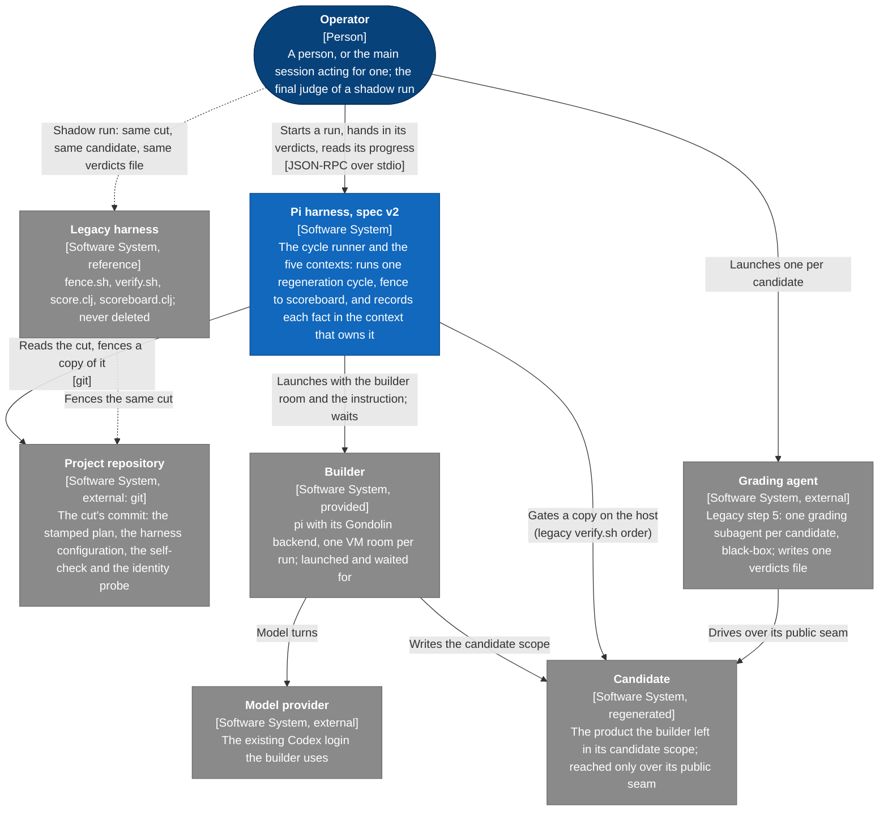
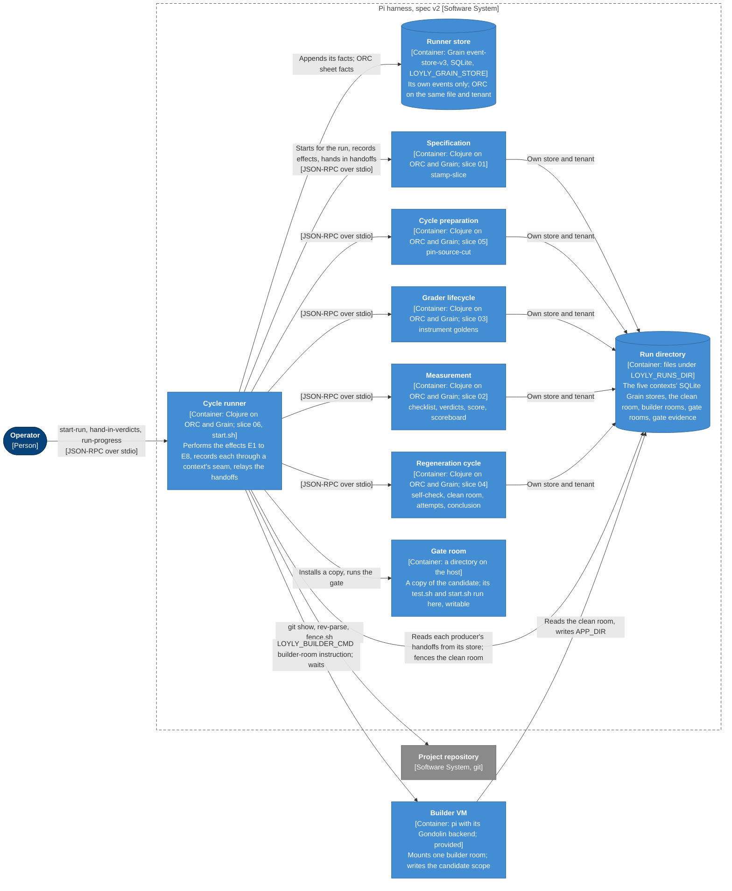
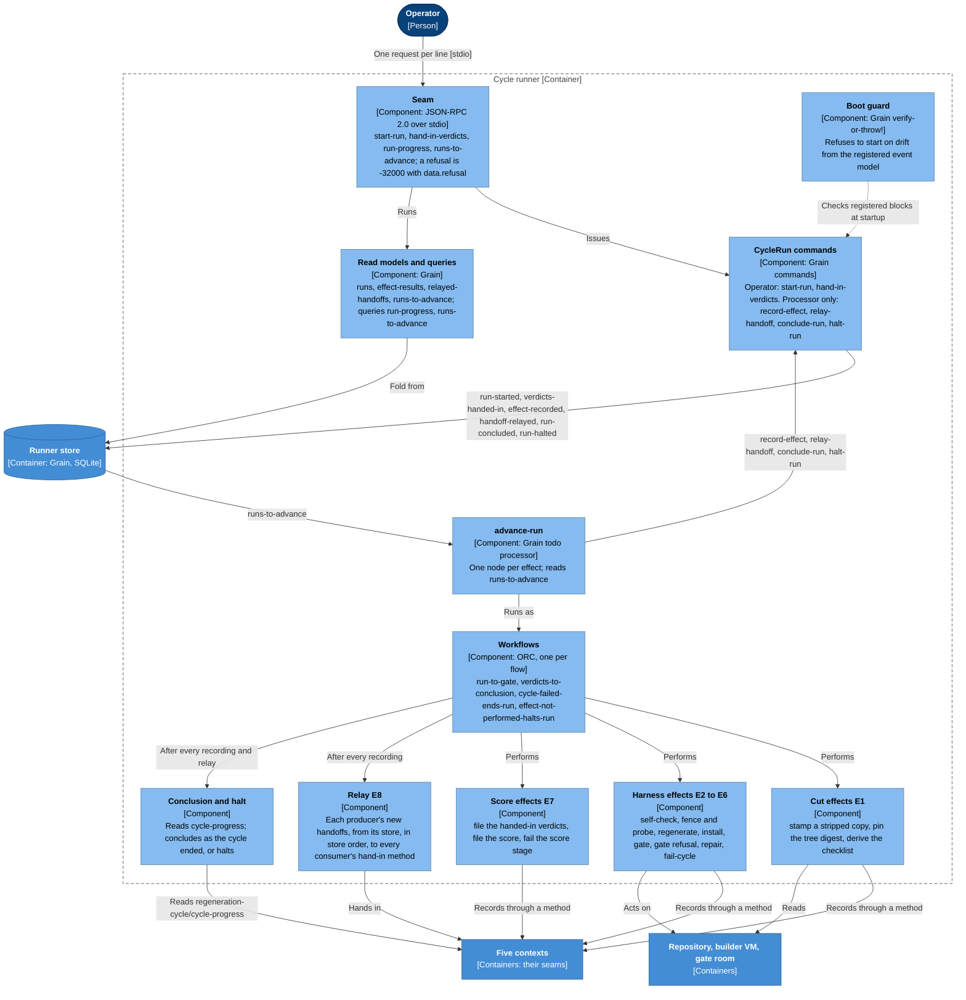

# Pi harness architecture

The architecture of spec v2 ([`.pi/spec/`](spec/README.md)) and of the harness as it runs since
the switch (`spec/decisions.md`, "The switch to the new harness"): the slice-06 cycle runner (its
cycle 03 candidate) driving the five contexts of slices 01 to 05, with `pi` and its Gondolin
backend as the builder and the legacy harness kept as the reference. Every element below is
taken from `.pi/spec/<context>/` (README, `domain-design.md`, `seam.md`, `event-model/`),
`spec/decisions.md`, `harness/README.md` and AGENTS.md. Where this page and the spec disagree,
the spec wins.

## C4 views

Three levels. Every context is its own runnable JVM with its own store; ORC and Grain are
libraries inside each JVM, so they appear only as components. "Technology bindings" below
names the technology behind each term.

### Level 1: System Context

Who uses the harness and what it depends on.



- The **operator** speaks only the runner's seam (`cycle-runner/seam.md`, "Methods"). The
  methods are synchronous: whoever watches a live run reads the runner's Grain store and the pi
  session directly (`spec/decisions.md`, "Spec round 7b" 5).
- The harness **never grades**: the verdicts file is handed in. In a shadow run the same file
  goes unchanged to the runner and to legacy `score.clj` (`cycle-runner/domain-design.md`,
  "Boundaries").
- The **builder's exit is not evidence**; the gate is.

### Level 2: Container

The runnable parts of the harness and the stores they use.



- **Six JVMs, six stores.** Each context is its own candidate, `harness-impl/NN-<context>/`,
  started by its `start.sh`, speaking JSON-RPC over stdio. Each keeps its own Grain store, and ORC
  shares that candidate's file and tenant; no store is shared across contexts (`spec/decisions.md`,
  "Spec round 5" 1).
- The runner starts the five named in `LOYLY_CONTEXTS` for each run, with a fresh store each in
  the run's directory and the fixtures it wrote there, and stops them when the run ends
  (`cycle-runner/seam.md`, "Handed in").
- The **gate room is the gate's**: a copy taken when the builder ended, out of the builder's
  reach, writable by the candidate's own run (`spec/decisions.md`, "Spec round 7d"). The gate runs
  on the host in stage 1; a Gondolin gate room is not in slice 06.

### Level 3: Component (cycle runner)

The responsibilities inside the cycle runner (`cycle-runner/event-model/`,
`cycle-runner/seam.md`).



- **It owns no rule of the five contexts.** A refusal it shows is the context's reply, recorded
  as an effect result (`outcome` `refused`); its run ends as its cycle ends
  (`cycle-runner/domain-design.md`, "Boundaries").
- Its own rules guard only its own facts: one run at a time, a cycle run once, the verdicts taken
  once and only for a gated candidate at an approved grader digest, each effect result and each
  relayed handoff recorded once.
- **A halt is never the cycle's conclusion**: a recording refused before the cycle opened (stamp,
  pin, checklist), a stamp whose identities are not the plan's own, a context that did not
  respond, or a handed-in command that could not be started.

## The seam

Every context, the runner included, is reached only through its `seam.md`: `start.sh` reads
JSON-RPC 2.0 requests on stdin, one per line, and writes one response per request carrying its
`id`; diagnostics go to stderr. Errors are `-32700` (not JSON), `-32601` (unknown method),
`-32602` (params off the schema) and `-32000` (a refusal, with `data.refusal`).

- **One method per command and per query**, named exactly as the block without the leading
  colon, its params the block's `:schema` verbatim.
- **One hand-in method per consumed handoff**, named exactly as the event, its params the event's
  contract in the producer's `event-model/handoffs.edn`. The context appends the event as given
  and runs no ORC workflow for it; these methods are the only way another context's event enters
  its store (`measurement/seam.md`, `regeneration-cycle/seam.md`, "The consumed handoffs, handed
  in").
- **Each command method runs as the ORC workflow of its flow** (`event-model/area.edn`), on the
  context's own store; the gate's event-store check requires every event a command produced to
  lie inside a completed run of that workflow (`spec/decisions.md`, "First light" 4).
- **The runner's own commands are not methods**: `record-effect`, `relay-handoff`, `conclude-run`
  and `halt-run` are issued only by `advance-run`; a request naming one is `-32601`.

| Context | Command methods | Hand-in methods |
|---|---|---|
| Specification | `stamp-slice` | none |
| Cycle preparation | `pin-source-cut` | none |
| Grader lifecycle | `write-instrument-golden`, `move-instrument-golden` | none |
| Measurement | `derive-checklist`, `file-item-verdicts`, `file-score`, `fail-score-stage`, `report-scoreboard` | `scenario-stamped`, `source-cut-pinned`, `gate-attempt-passed` |
| Regeneration cycle | `record-harness-self-check`, `prove-clean-room`, `record-regenerated-candidate`, `install-candidate-in-gate-room`, `record-gate-attempt`, `record-gate-refusal`, `pass-cycle`, `fail-cycle` | `source-cut-pinned`, `instrument-golden-written`, `instrument-golden-moved`, `measurement-filed`, `score-stage-failed`, `scoreboard-reported` |
| Cycle runner | `start-run`, `hand-in-verdicts` | none |

## Context map

The handoffs, producer to consumer, as the `event-model/handoffs.edn` files define them. The
runner produces and consumes none: it carries the others'.

```text
specification ──── scenario-stamped ────────────────────────► measurement
cycle-preparation ─ source-cut-pinned ──────────────────────► measurement, regeneration-cycle
grader-lifecycle ── instrument-golden-written / -moved ─────► regeneration-cycle
regeneration-cycle  gate-attempt-passed (one way) ──────────► measurement
measurement ─────── measurement-filed, score-stage-failed,
                    scoreboard-reported (to conclude only) ──► regeneration-cycle

cycle-runner: reads each producer's store, hands each handoff in to every consumer (the relay)
```

## The relay, and the deferred shared store

After every recording the runner relays (E8), as `harness/v2/assemble.clj` does: the producer's
handoff events not yet relayed are read from its store file, within its tenant, in store order,
and each is handed in unchanged (its `type` the method, its other fields the params) to every
consumer whose event model consumes it; `handoff-relayed` records the consumer's reply. A
handoff a policy issued, such as Measurement's `scoreboard-reported` inside `file-score`, travels
like any other, because it is taken from the store, not from command results
(`spec/decisions.md`, "Spec round 5" 1 and 2).

Deferred, the end state (option A1): one shared store with one fixed tenant, a consumer's read
models projecting from it and its policies polling it, to be taken up when ORC hosts all
contexts. The assembly gate's experiment showed why it waits: each candidate wrote its own Grain
tenant, and a todo processor's `start` sees only its own JVM's appends.

## The cycle

```text
stamp, pin, checklist → self-check → fence → regenerate → install, self-check, gate
      → (failed attempt, cycle still running: repair, at most three attempts)
      → hand-in-verdicts → file verdicts, file score → scoreboard → conclude
```

| Effect | What the runner does | Recorded through |
|---|---|---|
| E1 | Stamps a copy of each slice's spec file with its `@item` tags removed and checks the identities come back; pins the commit's tree digest; derives the checklist with legacy `gen_checklist`'s reading | `specification/stamp-slice`, `cycle-preparation/pin-source-cut`, `measurement/derive-checklist` |
| E2 | Runs `LOYLY_SELF_CHECK_CMD` (legacy `check.sh --local`), before the fence and before each gate | `regeneration-cycle/record-harness-self-check` |
| E3 | Legacy `fence.sh` as-is, then probes one root commit, one commit, no fenced path in the tree or the object graph | `regeneration-cycle/prove-clean-room`, or `fail-cycle` |
| E4 | A fresh builder room; `LOYLY_BUILDER_CMD <builder-room> <instruction>` launched and waited for within the regenerate timeout | `regeneration-cycle/record-regenerated-candidate` |
| E5 | Installs a copy in a fresh gate room; the gate in legacy `verify.sh`'s order and arguments, on the host | `install-candidate-in-gate-room`, `record-gate-attempt`, `record-gate-refusal` |
| E6 | After a failed attempt with the cycle still running: a fresh builder room with the previous candidate and the gate evidence, read-only, and the repair instruction | `record-regenerated-candidate` (`verification-repair`) |
| E7 | Files the handed-in verdicts and the score, or fails the score stage with the refusal as heard | `measurement/file-item-verdicts`, `file-score`, `fail-score-stage` |
| E8 | The relay, after every recording | each consumer's hand-in method |

Exhaustion, refusals, the stage clock and the conclusion are the Regeneration cycle's: its
policy `conclude-cycle` issues `pass-cycle` or `fail-cycle`, and its clock fails a stage that
outlived its timeout (`regeneration-cycle/seam.md`, "The conclude-cycle policy and the stage
clock"). The runner reads `regeneration-cycle/cycle-progress` after every recording and relay and
records `conclude-run` once the cycle passed or failed.

The fence and the gate are the **harness** and feed the build loop. The score and the scoreboard
are the **instrument** and never do: no score evidence reaches a builder, and a failed score is
measured, not retried within the cycle (AGENTS.md).

## The instrument

- The **checklist** is one item per stamped scenario of the selection, derived by Measurement and
  never written; an unstamped scenario or an empty selection stops the cycle (the run halts,
  `refused-before-the-cycle`).
- The **score** is honest: zero verdicts are refused, so no score is filed; an unreached item
  fails and stays in the denominator.
- The **scoreboard** compares with the last measured cycle of the same selection on shared items,
  newly passing and newly failing apart, new items as the untuned holdout, and never a net.
  Measurement's policy `report-scoreboard-once` reports it.
- **Grading today is legacy step 5**: a black-box grading agent per candidate drives it over its
  seam and writes one verdicts file, handed in unchanged; the main session judges `@item-01-011`
  of the Löyly app and hands that verdict in with the others. Nothing is sealed, calibrated or
  approved for these runs (`harness/README.md`, "Scoring a spec-v2 cycle"). A sealed Löyly
  grader and the product Grader (OG1) are still open (`spec/decisions.md`, "The switch to the new
  harness" 7).

## How it is checked

- **One context per cycle, before the switch**: `harness/v2/gate.sh NN ROOM` runs legacy
  `verify.sh` with the slice's probe, then reads the Grain store it handed the candidate
  directly (`harness/v2/event-store-check.sh`); `harness/v2/score.sh` files a verdicts file with
  legacy `score.clj` and `scoreboard.clj` (`spec/decisions.md`, "First light").
- **The assembly gate**: `harness/v2/assemble.sh` wires the five gated candidates through the
  relay, one story end to end, and reports the shared-store experiment.
- **The switch**: in shadow runs 4 and 5 the runner agreed with the legacy harness at every stage,
  fence to scoreboard, on the full Löyly app (11 items); since then the runner runs the cycles and
  the legacy harness stays as the reference. Until a run can resume after a restart, the runner is
  kept alive from start to the filed score.

## Technology bindings

| Term | Technology |
|---|---|
| A context's candidate | Clojure on ORC, with Grain; one JVM per context, `harness-impl/NN-<context>/start.sh` |
| ORC | `obneyai/orc`, the `orc-service` pin `af086675`; each command runs as the ORC workflow of its flow, on the context's own store |
| Event store | Grain's `event-store-v3`, SQLite backend, at `LOYLY_GRAIN_STORE`; Grain pin `dbf5b522` (`harness/v2/deps.edn`) |
| Seam | JSON-RPC 2.0 over stdio, one JSON object per line |
| Builder | `pi` with its Gondolin backend on the existing Codex login, launched as `LOYLY_BUILDER_CMD`; provided, never regenerated. The durable host on `@earendil-works/pi-durable` is not built |
| Gate | On the host, in legacy `verify.sh`'s order and arguments, in a writable gate room |
| Harness configuration | Legacy `config.sh` as-is, handed in as `LOYLY_HARNESS_CONFIG` |
| Legacy tools, v2 cycle tools | Babashka and shell: `harness/` and `harness/v2/` |

## Where the spec states it

| Concern | Where |
|---|---|
| The runner: effects, handed-in values, the relay, the conclusion | `.pi/spec/cycle-runner/seam.md`, `allium/`, `event-model/` |
| Stamps and item identity | `.pi/spec/specification/` |
| The source cut | `.pi/spec/cycle-preparation/` |
| Instrument goldens | `.pi/spec/grader-lifecycle/` |
| Checklist, score, scoreboard | `.pi/spec/measurement/` |
| Self-check, clean room, gate attempts, the cycle's conclusion | `.pi/spec/regeneration-cycle/` |
| Each context's boundaries and decisions | `.pi/spec/<context>/domain-design.md` |
| The handoffs | `.pi/spec/<context>/event-model/handoffs.edn` |
| Every decision, in order | `.pi/spec/decisions.md` |
| The tools, the legacy reference | `harness/README.md` |

Each context's accepted scenarios are its `spec.feature`, a slice through
`.pi/plan/NN-<context>`. Validate with `tools/spec/v2/gates.sh`.

## History

Spec v1, in `.pi/model/` and in git history (this page described it up to `3da969e`),
described the harness as one JVM: one `:loyly.pi-harness` Grain service area with an operator
control plane (cuts, selections, preparations, task submission), runtime evidence in validation
rooms, builder-instruction optimization through GEPA and a Bedrock reflection model, and a
durable builder host on `pi-durable` that ORC launched once per tick. Spec v2 replaced it with
six contexts built one per cycle; none of those v1 parts is in spec v2, and the durable host
is not built.
