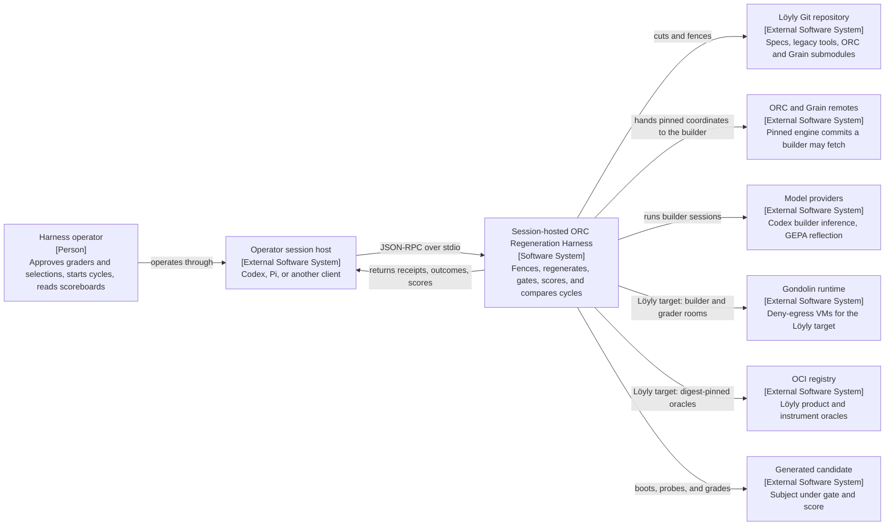
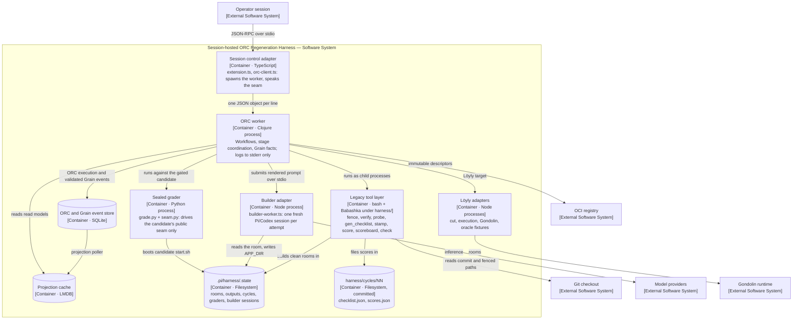
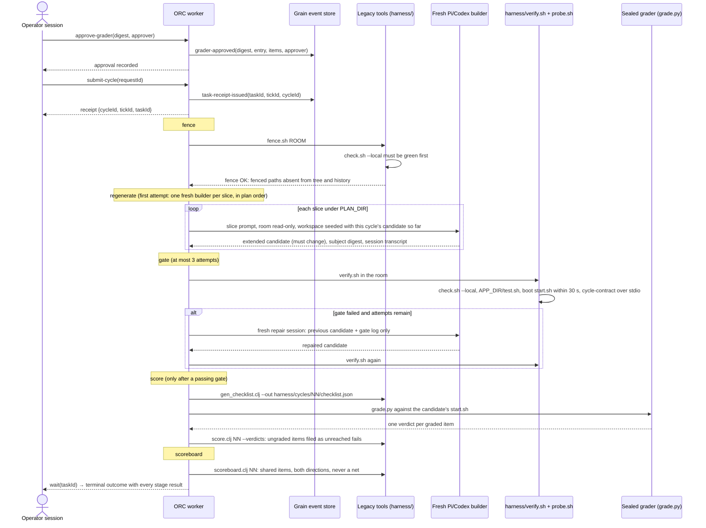
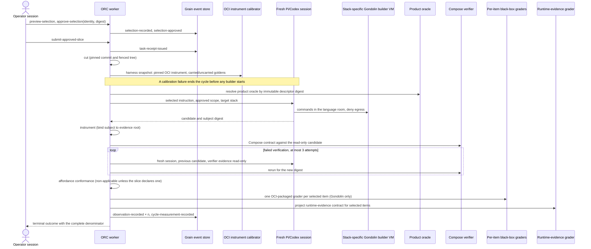
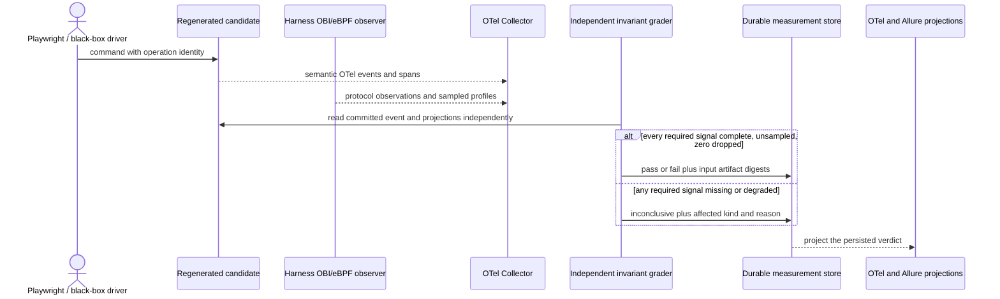
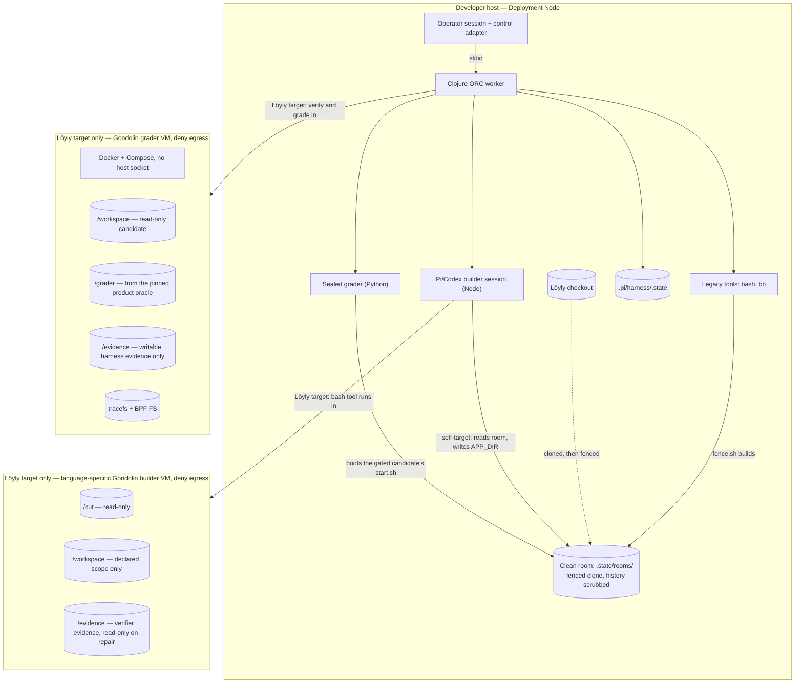

# Session-hosted ORC regeneration harness architecture

Status: rewritten for the legacy-shape harness cycle, with the Löyly slice cycle kept and
re-labelled, 2026-11-05

Audience: engineers evolving or reviewing the Pi regeneration harness

Decision supported: where workflow, isolation, persistence, prompt, and evidence
responsibilities belong, and which bounded contexts the harness is made of

## Scope

The software system in scope is the **Session-hosted ORC Regeneration Harness**. It turns a
pinned, fenced repository cut into a generated candidate, has a room the builder does not
control ratify that candidate, scores it with a sealed grader, and reports the score cycle
over cycle.

One ORC worker runs the harness against two targets:

| Target | Workflow | What it regenerates | Builder runs on | Gate | Score |
|---|---|---|---|---|---|
| **The harness itself** | `pi-harness-cycle` (`workflows/cycle.clj`, `core/legacy_cycle.clj`) | the harness, from `.pi/model` | host | `harness/verify.sh`, stdio seam | sealed `grade.py`, `harness/score.clj` |
| **Löyly** | `pi-harness-slice-cycle` (`workflows/slice_cycle.clj`) | a product slice, from `model/loyly` | language-specific Gondolin VM | Compose verifier | OCI-packaged black-box graders |

Both run the same shape, the shape of the legacy harness in
[`archive/legacy-harness`](../archive/legacy-harness/README.md):

```text
fence → regenerate → gate → score → scoreboard
```

The fence and the gate are the **harness**: they feed the build loop. The score and the
scoreboard are the **instrument**: they report to a person, once a cycle, and never into the
loop.

Inside the boundary are the session control adapter, the ORC worker, its Node adapter
processes, the legacy tool layer under `harness/`, the sealed grader under
`.pi/harness/instrument/`, and harness-owned state under `.pi/harness/.state/`. Outside are
the operator session host (Codex, Pi, or another client), the source repository and its ORC
and Grain submodules, model providers, the Gondolin runtime, the OCI registry, the Compose
runtime, and the generated candidate.

This document uses C4 terminology. A container is a runnable process or data store, not
necessarily a Docker container. Observable behavior is authoritative in
[`.pi/model`](model/README.md); this document describes how the implementation realizes it.
It is fenced out of every clean room (`FENCED_PATHS` in `harness/config.sh`), because it
describes an implementation, and an implementation is an answer. A builder learns the
harness's boundaries only from what the room holds: the plan slices, the Allium files, the
Grain Event Model (`.pi/model/regeneration_event_model.clj`), and the public seam
(`.pi/model/rpc.yaml`).

## System Context

Question answered: who uses the harness, what is inside its boundary, and which external
systems must it integrate with?



## Container view

Question answered: which runnable applications and data stores implement the harness, and
how do they communicate?



### Runtime-element responsibilities

| Runtime element | Owns | Must not own |
|---|---|---|
| Session control adapter | Worker lifecycle, seam transport, read-only inspection | Stage order, retries, scoring, prompts |
| ORC worker | Workflows and stage coordination; task receipts; prompt rendering; stage evidence; Grain commands and queries | VM implementation, UI behavior |
| Legacy tool layer (`harness/`) | The fence and its self-check, the gate's checks, checklist derivation, stamping, score filing, scoreboard; one byte contract (`hjson.clj`) | Workflow state; deciding what a cycle selects |
| Builder adapter | One fresh Pi/Codex session, confined workspace tools, transcript persistence | Prompt construction, grading, the denominator |
| Sealed grader | One verdict per graded item, through the public seam only | Candidate source, transcripts, prior verdicts |
| Löyly adapters | Cuts, Gondolin rooms, OCI oracle fixtures, Compose verification for the Löyly target | Changing the candidate or denominator |
| SQLite event store | ORC `:sheet/*` execution events and harness Grain facts | Product-domain events |
| LMDB projection cache | Durable read models | Authoritative history |
| `.pi/harness/.state` | Rooms, candidate outputs, gate logs, sealed graders, builder transcripts; ignored by Git and disposable | Verdict authority |
| `harness/cycles/NN` | The committed measurement record, one directory per scored cycle | Builder input: the fence removes it from every room |

## Bounded contexts

Question answered: which coherent responsibilities make up the harness, and where does each
live in the spec, the event model, and the code?

The contexts follow the worker's component structure and the Grain Event Model's service
area. They are not a second scope or item registry: the plan slices, their `Rule:` groups, and
the stamped `@item-NN-SSS` identities remain the regeneration and measurement keys. The first
regenerate attempt runs one fresh builder per plan slice, so each slice is carried by a session
of its own.

```text
                     ┌──────────────────────────┐
                     │ CONTROL PLANE            │  slices 09, 04, parts of 01
                     │ seam, cut/select/approve,│
                     │ submit, wait, receipts   │
                     └────────────┬─────────────┘
                                  │ commands and queries
                     ┌────────────▼─────────────┐
                     │ CYCLE ENGINE (ORC)       │  slice 02, parts of 01
                     │ stage order, outcomes,   │
                     │ gate repair, evidence ids│
                     └──┬─────────┬──────────┬──┘
           ┌────────────┘         │          └───────────────┐
 ┌─────────▼────────┐  ┌──────────▼─────────┐  ┌─────────────▼──────────┐
 │ CLEAN ROOM       │  │ BUILDER SESSIONS   │  │ INSTRUMENT             │
 │ fence, cut pin,  │  │ Pi adapter, scope, │  │ checklist, grader seal │
 │ self-check       │  │ observe, intervene │  │ and approval, score,   │
 │ slice 01, 02-003 │  │ 04-015..017        │  │ scoreboard   slice 03  │
 └──────────────────┘  └─────────┬──────────┘  └────────────────────────┘
                                 │
       ┌─────────────────────────┼───────────────────────┐
 ┌─────▼────────────┐  ┌─────────▼──────────┐  ┌─────────▼──────────┐
 │ PROMPTS / GEPA   │  │ RUNTIME EVIDENCE   │  │ PROJECT RUNTIMES   │
 │ slice 06         │  │ Löyly target       │  │ Löyly target       │
 │                  │  │ slice 05           │  │ slices 07, 08      │
 └──────────────────┘  └────────────────────┘  └────────────────────┘
```

| Context | Spec | Code | Grain facts |
|---|---|---|---|
| Control plane | 09, 04, parts of 01 | `durable_entrypoint.clj`, `entrypoint.clj`, `core/selection/*`, `src/orc-client.ts` | selection, cycle preparation, task receipt |
| Cycle engine | 02, parts of 01 | `core/worker.clj`, `workflows/*`, `core/legacy_cycle.clj` | ORC `:sheet/*`; generated candidate |
| Clean room | 01, 02-003 | `harness/fence.sh`, `harness/check.sh`, `src/cut.ts` | none yet |
| Builder sessions | 04-015..017 | `core/runtime/adapters.clj`, `src/builder-worker.ts`, `src/builder-session-*.ts` | none yet |
| Instrument | 03 | `harness/{gen_checklist,stamp_item_ids,score,scoreboard}.clj`, `.pi/harness/instrument/`, `core/oracle/*`, `core/grading/*` | observation, cycle measurement (Löyly target) |
| Prompts / GEPA | 06 | `prompt.clj`, `core/legacy_cycle.clj` (`render-prompt`) | none yet: activation is in memory |
| Runtime evidence | 05 | `core/evidence/*`, `src/grader-room.ts`, `harness/loyly/otel-*` | observation (runtime producer) |
| Project runtimes | 07, 08 | `harness/Makefile`, `harness/loyly/`, `.pi/harness/config/` | none |

Runtime evidence and project runtimes describe what the harness does when its target is
Löyly. They are requirements on the harness, not on the self-target cycle's own execution.

## Dynamic view: the harness cycle (self-target)

Question answered: what does `pi-harness-cycle` execute today, and which boundary owns each
step? This is descriptive of the checked-in implementation.



Rules this cycle enforces:

- **The fence is physical and proved.** `harness/fence.sh` clones the cut, removes every path
  in `FENCED_PATHS` from the tree and the history, and refuses if one matches nothing. It
  refuses to build any room unless `harness/check.sh --local` is green. The stage refuses a
  room directory that already exists.
- **The clean room** holds `.pi/model` (spec, Allium, Event Model, `rpc.yaml`), the legacy
  tools, `harness/loyly/` runtime files, and AGENTS.md. It holds no prior implementation,
  measurement, report, grader, or calibration fixture: `.pi/harness`, `.pi/architecture.md`,
  `harness/cycles`, `archive/legacy-harness/cycles`, `model/loyly`, `docs/plan`, `impl`, and
  `raw` are fenced.
- **The builders.** The first attempt runs one fresh builder per slice under `PLAN_DIR`, in
  plan order (`@item-02-012`). A slice builder's workspace is seeded with the candidate the
  earlier slice builders of this cycle left, and nothing else crosses in (`@item-02-013`); a
  slice builder that leaves the candidate unchanged stops the stage. Each builder is a fresh Pi session (`openai-codex/gpt-6.1-sol` by default,
  `PI_BUILDER_MODEL` to override), with compaction enabled, confined to the room read-only
  and `APP_DIR` (`harness-impl`) writable. Its prompt is ORC data rendered by
  `legacy_cycle/render-prompt`, with the target stack and pinned engine coordinates. An
  engine pin is the submodule's merge-base with `origin/HEAD`, so the builder can fetch it.
- **The gate** is a room the builder does not control. Done is its verdict, not the builder's
  claim. A failed gate may start a fresh builder with only the previous candidate and that
  attempt's gate log, three attempts in total.
- **The score** runs every operator-approved grader (Grain `grader-approved` facts); it refuses
  with none, and refuses when two approved graders file the same item. Approval itself refuses
  a grader whose items overlap an approved one. Zero
  verdicts mean no score was filed; an item the grader does not reach is a fail and stays in
  the denominator.
- **The scoreboard** reports newly passing and newly failing separately on shared items and
  counts new items as the untuned holdout.

### The public seam

`.pi/model/rpc.yaml`: one JSON object per line on stdin, `{id, method, params}`; one response
per request on stdout, `{id, ok, result | error}`; nothing else on stdout, logs on stderr
(`orc-worker/logback-stderr.xml`). An unknown method is refused by name and the harness keeps
running. The self-target cycle uses `cycle-contract`, `submit-cycle`, `wait`,
`execution-status`, and `approve-grader`. The same worker also answers the Löyly-target and
optimization methods (`preview-selection`, `approve-selection`, `prepare-cut`,
`submit-approved-slice`, `optimize-prompt`, `builder-session`, `measurement`, and others).

### The sealed grader

```text
author (spec + calibration protocol only) → calibrate → seal by digest → operator approves → reuse
```

- `.pi/harness/instrument/grade.py` drives the candidate through `seam.py`, the stdio client.
- `calibrate.py` runs every item against the **carried** fixture (`carried-start.sh`: the real
  harness) and against an **uncarried** proxy per item (`uncarried.py`: the real harness with
  exactly one behavior broken). Every carried case must pass and every uncarried case must
  fail, or nothing is sealed.
- The seal is the SHA-256 of `grade.py` and `seam.py`, stored under
  `.state/graders/sealed/<hex>/` with a manifest of items and calibration cases.
- The approved grader today is `sha256:302072fd…`, covering 8 items: `02-001`, `02-002`,
  `02-010`, `04-009`, `04-010`, `09-001`, `09-002`, `09-003`. The other 72 are recorded as
  unreached fails.
- A grader can only be calibrated on behavior the real harness carries, so the reference
  implementation's coverage bounds the grader's.

## Dynamic view: the Löyly slice cycle

Question answered: what does `pi-harness-slice-cycle` execute for the Löyly target? It keeps
the five-stage shape at finer grain, with one route selecting fresh generation or measured
regeneration.



The stage order is `cut → harness-snapshot → oracle → builder → instrument → verify →
repair-verification → affordance-conformance → grade → instrument-conformance →
repair-evaluation → conclude`. Product oracles and instrument oracles are pinned by OCI
descriptor digest; tags are lookup aliases only. Runtime signals that are missing, sampled,
or dropped are `inconclusive` and cannot pass; Allure and OTLP JSON results are projections of
the persisted verdict and never author it.

### Runtime evidence (Löyly target)



## Deployment and security perspective

Question answered: where do instances run, and which mounts and capabilities cross trust
boundaries?



The self-target cycle runs its builder on the host. The host preserves the logical paths
(room read-only by contract, `APP_DIR` the only declared write scope) but not Gondolin's
isolation: a host builder inherits the host environment. It is the operator's chosen trade
for regenerating the harness, and a host-built Löyly candidate still cannot claim an
independently graded pass. The Löyly target runs builders and graders in deny-egress
Gondolin rooms with synthetic DNS and no operator transcript.

## Data and event ownership

| Stream or artifact | Authority | Purpose |
|---|---|---|
| ORC `:sheet/*` events | ORC | Workflow execution, task progress, stage results |
| `:loyly.pi-harness/task-receipt-issued` | Harness Grain model | Binds a public task id to its ORC tick so a replacement worker answers `wait` |
| `:loyly.pi-harness/selection-*` | Harness Grain model | The reviewed and approved denominator |
| `:loyly.pi-harness/cycle-preparation-*` | Harness Grain model | The approved scope, stack, profile, pinned inputs, diagram, and budget |
| `:loyly.pi-harness/approved-slice-operation-routed`, `generated-candidate-recorded` | Harness Grain model | Route and candidate provenance for the Löyly slice cycle |
| `:loyly.pi-harness/oracle-proposal-*`, `product-oracle-accepted` | Harness Grain model | Löyly product-oracle review and acceptance |
| `:loyly.pi-harness/observation-recorded`, `cycle-measurement-recorded` | Harness Grain model | Löyly-target verdict provenance and measurement |
| `:loyly.pi-harness/grader-approved` | Harness Grain model | An operator's approval of one sealed grader's exact digest, its entry file, and the items it covers |
| `.state/graders/sealed/<hex>/` | Sealed grader store | The sealed grader files and their calibration manifest |
| `harness/cycles/NN/{checklist,scores}.json` | Legacy instrument | Self-target measurement record, committed |
| `harness/oracle/*.golden*` | Legacy oracle | Goldens re-recorded only for a recorded reason |
| Builder transcripts | `.state/builder-sessions/` | Read-only inspection of each builder session |
| Generated product-domain events | `model/<project>` and the candidate | The product's behavior, never duplicated here |
| Allure results and logs | Derived report store | Projections; never verdict authority |

The harness introduces no second scope or item registry. Slices, `Rule:` groups, and stable
`@item-*` identities remain the keys.

## Architectural invariants

1. ORC/Clojure owns workflow state, stage order, retries, scoring, and production prompts;
   TypeScript remains adapter code.
2. Every cycle has the legacy shape, fence → regenerate → gate → score → scoreboard. The
   fence and the gate feed the loop; the score and the scoreboard never do.
3. No room is built until the harness self-check passes, and the fence proves every fenced
   path absent from the tree and the history.
4. A builder is a fresh, separately identified session with no operator transcript or skills,
   reading the room and writing only its declared scope.
5. Done is the gate's verdict. A repair builder receives only the previous candidate and that
   attempt's gate evidence, never score evidence, at most three attempts.
6. A score uses only an operator-approved grader digest. A failing score never replaces a
   grader; a replacement records its reason.
7. Unreached items are failed denominator items; zero verdicts mean no score.
8. Missing, incomplete, sampled, or dropped required runtime signals are `inconclusive`.
9. Grain changes go through command → validated event → projection. Durability comes from
   ORC and Grain, not from files a component writes for itself.
10. Generated output is persisted only from an ORC stage; report projections cannot change a
    recorded verdict.
11. Progress views and builder-session views are observational; only ORC execution state
    advances a cycle.

## Evidence and traceability

- Engineering boundaries: [`AGENTS.md`](AGENTS.md) and the root [`AGENTS.md`](../AGENTS.md)
- Legacy reference: [`archive/legacy-harness/README.md`](../archive/legacy-harness/README.md)
- Legacy tools and their deviations: [`harness/README.md`](../harness/README.md), `harness/config.sh`
- Public seam: [`model/rpc.yaml`](model/rpc.yaml)
- Self-target cycle: [`workflows/cycle.clj`](harness/orc-worker/src/loyly/pi_harness/workflows/cycle.clj), [`core/legacy_cycle.clj`](harness/orc-worker/src/loyly/pi_harness/core/legacy_cycle.clj)
- Löyly slice cycle: [`workflows/slice_cycle.clj`](harness/orc-worker/src/loyly/pi_harness/workflows/slice_cycle.clj)
- Worker and receipts: [`core/worker.clj`](harness/orc-worker/src/loyly/pi_harness/core/worker.clj)
- Grain model: [`grain/`](harness/orc-worker/src/loyly/pi_harness/grain/) and [`model/regeneration_event_model.clj`](model/regeneration_event_model.clj)
- Sealed grader: [`harness/instrument/`](harness/instrument/)
- Builder adapter: [`harness/src/builder-worker.ts`](harness/src/builder-worker.ts)
- Durable stores: [`core/runtime/durable_system.clj`](harness/orc-worker/src/loyly/pi_harness/core/runtime/durable_system.clj)
- Scored cycles: [`harness/cycles/`](../harness/cycles/)
- Session and cycle ownership decision: [`ADR 0001`](model/docs/adr/0001-session-and-cycle-ownership.md)

## Assumptions and open questions

- **Prompt activation is in memory.** An optimized instruction needs a durable owner and a
  rollback policy before it is production configuration.
- **Grader coverage is 8 of 80.** Widening it needs an author who has seen no candidate, and
  it is bounded by what the real harness carries. Items on the Löyly target need a full
  Löyly cycle per grading run.
- **Slices stand in for bounded contexts.** Cycles 03 and 04 each stopped near fifty tool calls
  in one session with 32 and 48 scenarios uncarried, so the first attempt now runs one builder
  per slice. The slices are close to, but not exactly, the contexts above; re-cutting them
  would first need each context's commands, events, and queries declared in the Event Model
  and `rpc.yaml`, keeping every item id.
- **Builder sessions are not durable.** Transcripts persist for inspection only;
  `@earendil-works/pi-durable` could make a session resumable and linked to its ORC tick.
  This is parked until the self-target cycle produces a real candidate.
- **The pinned ORC is behind the local branch.** The builder's ORC is the submodule's
  merge-base with `origin/HEAD`; three local ORC commits (external GEPA proposer, the
  Pi-compatible agent loop, the Grain event-model runtime) are not on the remote.
- **Host execution is not Gondolin.** It is acceptable for regenerating the harness and must
  stay visibly non-ratifying for a Löyly candidate.
- Pause, steer, and fork of a builder session, transcript-to-workspace binding, and
  parent-cycle lineage remain unimplemented.

## Appendix A: implementation conformance

The spec has 82 stamped items across 9 slices (80 when cycles 01–04 were scored). Status is measured, not claimed: the self-target
cycle's sealed grader is the authority for the items it covers, and the rest are recorded as
unreached until a grader covers them.

### Self-target scoreboard

| Cycle | Run | Builder | Tool calls | Candidate | Score | vs previous |
|---|---|---|---:|---|---:|---|
| 01 | `harness-regen-5` | gpt-5.6-luna | 13 | stub with canned stage results | 6/80 | baseline |
| 02 | `harness-regen-6` | gpt-5.6-luna | 20 | stub, 62 lines | 7/80 | +1 / −0 |
| 03 | `harness-regen-7` | gpt-6.1-sol | 44 | real ORC pipeline over Grain, legacy tools reused, 32 scenarios listed uncarried | 8/80 | +1 / −0 |
| 04 | `harness-regen-8` | gpt-6.1-sol | 50 | real core on a fetchable ORC pin, 48 scenarios listed uncarried | 8/80 | +0 / −0 |

Cycles 03 and 04 passed all 8 graded items, so its score is limited by grader coverage, not by the
builder. The record is under [`harness/cycles/`](../harness/cycles/).

### Coverage by slice

| Slice | Items | Sealed grader covers | Reference implementation |
|---|---:|---|---|
| 01 regeneration cycle | 15 | — | fence, room, gate, and receipts in the self-target cycle; cut, selection, and approval in the Löyly cycle |
| 02 execution pipeline | 13 | 02-001, 02-002, 02-010 | five ordered stages, stdio identity, 30 s boot budget, gate repair, one builder per slice |
| 03 instrument | 9 | — | legacy checklist, stamp, score, scoreboard; sealed and approved grader |
| 04 operator control plane | 17 | 04-009, 04-010 | Grain service area, wait, receipts across restarts, read-only builder sessions |
| 05 runtime evidence | 10 | — | Löyly target: Playwright, OTel/Allure projections, OBI/eBPF image |
| 06 prompt optimization | 9 | — | ORC-owned prompts; GEPA scoring; activation in memory |
| 07 harness bootstrap | 3 | — | `harness/Makefile` |
| 08 project VM config | 2 | — | `harness/loyly/` by convention |
| 09 rpc seam | 4 | 09-001, 09-002, 09-003 | stdio JSON-RPC, idempotent submit, terminal wait |
| **Total** | **82** | **8** | |

### Verification

- `harness/check.sh --local`: the legacy oracle and adoption check are green; cross-repository
  comparison is skipped when no sibling is named.
- ORC worker: 151 tests, 543 assertions, 0 failures (`orc-worker/check.sh`).
- Node: 39 passing, 0 failing (`npm test`).
- Grader calibration: 8 carried pass, 8 uncarried fail, no orphaned processes.

### Latest Löyly-target evidence

The 2026-11-02 comparison independently graded four regenerated Löyly applications
(TypeScript, Rust, Java, Rails) against the eleven booking-core items, 44/44 in total, with
profiling evidence for one item retained as diagnostic only. It demonstrates the Löyly
target; it does not stand in for the harness's own conformance.

```text
self-target cycle shape        [##########]  fence → regenerate → gate → score → scoreboard
legacy tool parity             [##########]  check.sh --local green, goldens recorded
stdio seam + gate              [##########]  identity by cycle-contract, 30 s budget
durable receipts               [##########]  Grain task-receipt facts
sealed grader                  [##########]  calibrated, approved
grader coverage                [#---------]  8 of 80 items
regenerated harness            [###-------]  cycle 03: real core, 32 scenarios uncarried
Löyly slice cycle              [########--]  live; preparation approval selection-only
GEPA activation                [######----]  scoring works; activation not durable
builder intervention/restore   [##--------]  read-only inspection only
```
